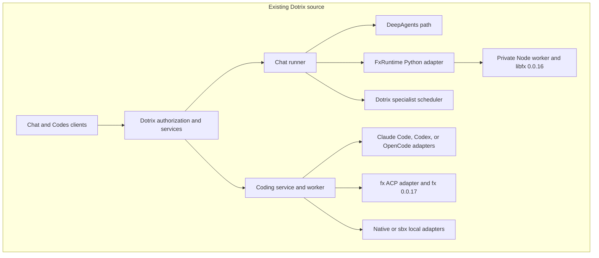
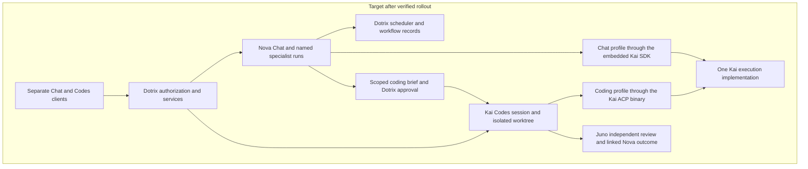

# Dotrix integration audit for Kai

Dotrix already has boundaries that can host Kai without rebuilding its project-management backend. Replace the existing fx integrations first, verify their saved-state and policy contracts, then change admission for new sessions. Retire DeepAgents, Claude Code, Codex, and OpenCode after parity and rollback evidence exists.

This is a source audit and proposed migration map, recorded on 18 November 2026. It does not establish deployed behavior, provider quality, journal compatibility, or release readiness. No runtime, database, deployment, or CI policy is changed by this document.

## Scope and evidence

| Repository surface | Audited revision |
| --- | --- |
| Dotrix `origin/stage` | `b039f6cfa47abaaec5aa6a6f31470491413f524c`, refreshed from the remote for this audit |
| Dotrix local checkout | `c327ffa526587a7cdc2f09296291ea4a28495053`; preserved with its existing changes |
| Private Kai `origin/fx-baseline` | `82c6a80fdf50d0336a53bdcb100fe35f8c187353`; includes self-hosted Linux routing and the upstream printf repair |
| Kai local qualification branch | `9b0b8ae326e20c3d747517f8541f73565ac20f11`; baseline repair work remains under verification |

Dotrix paths below refer to the audited `stage` revision, including files absent or older in the local checkout. Read those files from the pinned Git revision when preparing patches. Refresh this audit if `stage` advances before implementation.

The accepted destination is [one runtime for Chat and Coding](KAI_DOTRIX_NEW_DIRECTION.md), with [skills and browser integration](DOTRIX_KAI_SKILLS_BROWSER_ARCHITECTURE.md) as staged follow-up work. These documents describe the target architecture. Their proposed commands, events, folders, and execution snapshots are not implemented interfaces by virtue of appearing in a plan.

Dotrix's untracked Plan 046 is useful as an inventory of the existing fx slots. Its instruction to retain all other engines describes an intermediate milestone. Its proposed fresh-turn resets and fresh coding sessions require further review against the newer state-preservation direction. This audit does not execute that plan or edit it.

Applicable Kai rules are **R1.1, R1.4, R1.8, R2.4, R3.3, R3.4, R3.5, R3.6, R4.1, R4.3, R4.8, R5.3, R5.4, R7.3, R7.4, R7.5, R7.6, R8.2, and R8.3**.

## Existing and target execution paths

One runtime implementation can retain the existing embedded Chat SDK and Codes ACP transports. Replacing both transports with a new protocol is a separate decision that needs evidence. Each execution keeps its own process, context, credentials, and permission scope where required by the host boundary.

## Integration map

Paths in this table are relative to Dotrix.

| Surface | Existing source and behavior | Migration action |
| --- | --- | --- |
| Fixed identities | `packages/engine/src/dotrix_engine/team.py` and `builtins.py` define Nova, Lyra, Orion, Vega, Juno, Echo, and Kai. | Preserve product identities and role contracts. A runtime rename does not create new team members. |
| Framework-neutral Chat API | `packages/engine/src/dotrix_engine/runtimes/contracts.py` defines configuration, tools, events, journal storage, turn results, and the conversation runtime protocol. | Reuse this host boundary and add only contracts required by a verified gap. |
| Embedded fx adapter | `runtimes/fx.py` fingerprints `libfx-0.0.16`, checks the installed package directory, and launches the Node worker over private stdio. | Update package resolution, fingerprint, and diagnostics together. Preserve tool dispatch and process cleanup. |
| Node host | `runtimes/fx_host/package.json` pins `libfx` at `0.0.16`; `worker.mjs` imports the agent/engine factories, fencing error, memory store, and durable-local store. | Install the private Kai package and verify the exports and durable behavior actually used by this host. Keep the lockfile reproducible. |
| Chat run policy | `apps/backend/src/dotrix_backend/modules/agents/fx_pilot.py` assembles scoped tools/context and pins `libfx-0.0.16-chat-3` or `libfx-0.0.16-delegation-3`. | Version the new execution binding. Preserve context snapshots, model selection, requester identity, lease checks, usage, and approval recovery. |
| Identity validation | `agents/runtime_sessions.py:34` defines `RuntimeIdentity`; its validator accepts only `deepagents` and `fx`. | A new stored `kai` identity needs explicit validator and compatibility changes. Keeping the `fx` identity during the slot pilot avoids an unnecessary stored-value migration. |
| Writes and approvals | `agents/fx_tools.py` claims each changing call before execution and saves its encrypted result. Unknown outcomes are not automatically repeated. | Retain the host ledger and approvals. Test the same execution ID across worker failure and approval resume. |
| Journal and fencing | `agents/runtime_journal.py` encrypts bounded opaque records/checkpoints and checks the run lease. | Verify old journals against the exact new SDK. Keep original records and a recovery route for incompatible active runs. |
| Named specialists | `agents/delegation.py`, `specialist_sessions.py`, and `runner.py` own task trees, continuity, leases, and child policy. | Keep scheduler ownership. Evaluate runtime child primitives later without replacing durable named-specialist records. |
| Steering and follow-ups | `agents/chat_inputs.py` and runtime-specific runner branches deliver ordered private inputs. | Preserve delivery IDs, authorization, cancellation, and distinctions between acceptance and completion. |
| Nova to Kai | `modules/coding/service.py` freezes a brief and origin references and applies approval before execution. `agents/coding_outcomes.py` returns outcomes through the originating Chat runtime. | Preserve the linked sessions and independent Juno review. Test this journey when old and new bindings coexist. |
| Cloud coding adapter | `modules/coding/tools.py:704` defines `Fx`, invokes the Node ACP driver, parses events, and saves/restores `.fx` state without `settings.json`. | Change the pinned binary, driver, and state policy as one compatible unit. Retain the stored `CodingAgent.FX` slot initially. |
| ACP bridge | `infra/coding/fx-acp.mjs` initializes ACP, creates/resumes/loads sessions, selects `full-access`, prompts, streams updates, and requests cancellation. | Verify the same wire contract against the built Kai artifact before renaming paths or methods. |
| Coding image | `infra/coding/Dockerfile:36` pins fx `0.0.17` from `releases.fx.sh` with checksum verification. | Build Kai from an immutable private source revision and pinned toolchain. Record image digest, binary identity, and source SHA together. |
| Cloud placement | `modules/coding/runner.py`, `environments.py`, `sandbox.py`, and `docker_cloud.py` manage isolated execution and approved environment images. | Preserve environment snapshots, image identity, deployment isolation, egress policy, and host-owned publication. A new engine does not authorize an arbitrary image. |
| Native local fx | `apps/cli/src/dotrix_cli/fx_local.py`, `fx_native.py`, and `fx_bridge.py` prepare a restricted profile, launch Linux Bubblewrap isolation, and relay model/browser calls. | Migrate the local path separately. Update its exact-version handshake, profile files, binary mounts, environment names, and relay together. |
| CLI and desktop admission | `apps/cli/src/dotrix_cli/runner.py` selects adapters and checks native fx availability. Desktop uses the local runner path. | Preserve supported-host checks and fail-closed behavior. Cloud success does not establish Windows or macOS native support. |
| Choice and defaults | Chat models/service/schemas retain DeepAgents defaults. Coding `tools.py` has provider-based engine routing and legacy fallbacks. | Change new-session admission after the pilot. Pin existing sessions to their recorded runtime and model. |
| UI and API | `apps/web/src/screens/Chat.tsx` offers runtime choices; `Settings.tsx` exposes coding-engine preferences. Runtime and engine values appear in API schemas. | Retire selectors after server admission changes. Preserve model choice and historical values. Regenerate OpenAPI/client types if public schemas change. |
| Build installation | `.github/workflows/ci.yml:99` installs the Chat host package; `deploy/backend.Dockerfile` copies its dependencies into the backend image. | Configure private package access for both CI and image builds. Build-time credentials must not remain in shipped layers or worker environments. |

## Contracts to preserve

### Chat execution

The existing `ConversationRuntime` protocol has `new_session`, `prompt`, `resume`, `steer`, `cancel`, and `close`. It exposes capabilities separately. `FxRuntime` enables persistence and resume when configured with a local store or host journal; class-level capability flags alone do not establish full platform crash recovery.

`AgentRuntimeConfig` contains an identity, instructions, and the admitted tools. `RuntimeToolContext` carries correlation IDs, not authorization. Dotrix tool handlers must continue checking the requester, project, effective contract, and lease independently.

The current runtime event types are `turn_accepted`, `text_delta`, `reasoning_delta`, `tool_start`, and `tool_end`. The richer event envelopes in the direction documents are proposals. Map existing events to persisted Dotrix run/turn/tool identifiers before deciding which additional fields are necessary. Do not infer a durable sequence or deduplication guarantee from a streaming callback alone.

`RuntimeJournalStore` exposes `load`, `append` with an expected cursor and idempotency key, and `save_checkpoint`. Preserve these opaque records through an SDK upgrade. The existence of matching factory names in Kai's SDK does not prove that libfx 0.0.16 journals can be read by the new build.

### Coding execution

The existing coding boundary already carries session IDs, model/provider configuration, started/text/tool/result/done events, saved engine state, and cancellation. Preserve those contracts before unifying further interfaces.

The cloud ACP driver selects `full-access` and answers unexpected permission requests with an allow option when available. Its security boundary is the admitted isolated worker and host workflow. This is not a Chat permission model and must not be copied into Chat. Any future change to interactive coding approvals needs its own explicit bridge and tests.

Native fx additionally requires an exact `0.0.17` helper handshake, a custom Chat Completions API-key profile, and working Linux Bubblewrap namespaces. It removes unrelated saved credentials and routes model/browser access through a host relay. Renaming the executable alone will fail this admission path. Keep unsupported hosts and sign-in modes refused until their isolation is verified.

### Identity and delegation

| Visible identity | Existing stable handle | Execution owner |
| --- | --- | --- |
| Nova | `project-manager` | Chat runner and admitted runtime |
| Lyra | `product` | Dotrix specialist scheduler |
| Orion | `architecture` | Dotrix specialist scheduler |
| Vega | `research` | Dotrix specialist scheduler |
| Juno | `reviewer` | Independent scheduled review |
| Echo | `documentation` | Dotrix specialist scheduler |
| Kai | `coding-agent` | Coding service and isolated worker |

Temporary coding workers are children of the authorized coding execution. They do not become fixed specialists or acquire authority to start platform workflows. A single Kai implementation must preserve these ownership differences.

## State and rollback inventory

| Saved surface | Required treatment |
| --- | --- |
| Chat runtime enum and binding | Keep historical values readable. Define which artifact may resume each version and configuration digest. |
| Pending approvals and claimed tool calls | Preserve call IDs and results. Reconcile an unknown effect before retrying. |
| Chat journal and checkpoint | Test upgrade/resume using old fixtures and the actual private SDK. Preserve originals on incompatibility. |
| Coding `.fx` archives and session mapping | Specify a tested import or route to the old binary. Avoid silently treating a failed restoration as a successful migration. |
| Native local profiles | Import only eligible runtime settings. Retain profile isolation and avoid carrying over remembered grants. |
| Coding environment snapshot and image ID | Resume with an approved compatible image and verify its engine identity. Do not substitute the latest image implicitly. |
| Origin Chat, coding run, Juno review, and published outcome | Preserve privacy and links. Shared outcomes must not expose private briefs or transcripts. |

Rollback should change admission for new work and retain the old artifact for eligible active sessions. It must account for work already written in the new format; an old image is not automatically a reader for new state. Stop affected admissions if recovery, permissions, or isolation regress. **R3.3, R3.4, R3.5, R4.8, R8.4.**

## Proposed implementation order

Each row is a separately reviewable change or evidence checkpoint. This audit does not authorize deployment or publication.

| Order | Scope | Exit evidence |
| --- | --- | --- |
| 0 | Finish baseline repair and verify the exact candidate. | Required CI, focused tests, and a real built-binary interaction. Record unavailable platforms explicitly. |
| 1 | Review inherited release/publish workflows and define private artifact identity. | No accidental upstream publishing; selected private package scope/registry and credential path; preserved licenses and notices. |
| 2 | Produce compatible branded artifacts from one reviewed SHA. | SDK exports and ACP remain compatible; state import/rollback policy tested; version/source/image identity recorded. |
| 3 | Replace the Chat fx package slot and execution binding. | Nova turn, allowed/denied write, specialist delegation, steering, cancellation, approval resume, and killed-worker recovery through the private SDK. |
| 4 | Replace the cloud coding fx binary and driver slot. | Built Kai runs through Dotrix ACP with isolated workspace, model relay, tool activity, cancellation, saved-state resume, and linked outcome. |
| 5 | Adapt native CLI/desktop execution. | Version handshake, restricted profile, relay, isolation, cleanup, and supported-host checks pass with the actual binary. |
| 6 | Default new Chat and coding sessions to Kai. | Model capability coverage, fixed-team behavior, human approvals, outcome privacy, and rollback rehearsal pass. Existing work retains its binding. |
| 7 | Drain and retire legacy engine admissions and adapters. | Every active binding accounted for; retained state remains readable; obsolete UI choices and dependencies removed with schema compatibility handled. |
| 8 | Pilot the skills registry and sandboxed Agent Browser integration. | Pinned skill provenance and independent permission enforcement; browser cancellation/artifact controls; deterministic Playwright regression evidence. |

Keep SDK and ACP transports for the initial migration. Decide later whether a shared higher-level envelope reduces maintenance enough to justify another protocol change. **R6.3, R8.2.**

## Verification map for implementation

These are existing tests to inspect and extend when implementing. They were located in source and were not executed during this audit.

| Changed area | Starting verification owners in Dotrix |
| --- | --- |
| Runtime host and configuration | `packages/engine/tests/test_chat_runtimes.py`; `runtimes/fx_host/handoff.test.mjs` |
| Chat permissions, tools, recovery | `apps/backend/tests/integration/test_fx_changes.py`, `test_runtime_tools.py`; `apps/backend/tests/unit/test_fx_pilot.py`, `test_runtime_tool_failures.py` |
| Steering and specialists | `apps/backend/tests/integration/test_chat_inputs.py`, `test_specialist_continuity.py`, `test_agent_scripts.py`; `apps/backend/tests/unit/test_specialist_scheduler.py` |
| Coding ACP and engine routing | `apps/backend/tests/unit/test_fx_coding.py`, `test_coding.py`; `apps/backend/tests/integration/test_coding.py` |
| Environment image and recovery | `apps/backend/tests/unit/test_coding_environment_execution.py`, `test_coding_docker.py`; `apps/backend/tests/integration/test_coding_environments.py`, `test_coding_reconcile.py` |
| Native execution | `apps/cli/tests/test_fx_native.py`, `test_local_engines.py`, `test_real_local_engines.py` |
| Linked handoff and private outcomes | `apps/backend/tests/integration/test_shared_coding_outcomes.py`; `apps/web/e2e/nova-team.spec.ts`, `inbox-coding.spec.ts`, `shared-coding-outcomes.spec.ts` |

Add cross-version journal and coding-state fixtures before changing readers. Add deterministic regressions for each behavioral repair. Run focused checks during development and required repository CI before rollout. Real artifact-driven Chat and Codes interactions remain required; mocked adapter success does not establish deployed support. **R7.1, R7.3, R7.5, R7.6.**

## Decisions still needed before dependent implementation

1. Private SDK package scope, registry, and CI/build authentication. No package is published by this audit.
2. Version naming and the recorded relationship between SDK, native binary, source commit, and image digest.
3. Backward compatibility for `FX_*`, `.fx` paths, stored `fx` identities, and existing journals. Prefer preserving stored identifiers during the pilot; apply the CLI-shape process to actual control changes.
4. Which models/providers pass tool, streaming, cancellation, and context requirements through Kai. Existing endpoint lists are not a verified capability matrix.
5. Release support by execution location and OS. Mac/ARM CI availability and native Windows/macOS isolation are separate unresolved concerns.
6. Comparative task workloads and acceptance thresholds for retiring each legacy engine.

## Source anchors

- [Dotrix fixed team](https://github.com/adeyemiadekunle/dotrix/blob/b039f6cfa47abaaec5aa6a6f31470491413f524c/packages/engine/src/dotrix_engine/team.py)
- [Chat runtime contracts](https://github.com/adeyemiadekunle/dotrix/blob/b039f6cfa47abaaec5aa6a6f31470491413f524c/packages/engine/src/dotrix_engine/runtimes/contracts.py)
- [Chat runtime adapter](https://github.com/adeyemiadekunle/dotrix/blob/b039f6cfa47abaaec5aa6a6f31470491413f524c/packages/engine/src/dotrix_engine/runtimes/fx.py)
- [Host policy and version binding](https://github.com/adeyemiadekunle/dotrix/blob/b039f6cfa47abaaec5aa6a6f31470491413f524c/apps/backend/src/dotrix_backend/modules/agents/fx_pilot.py)
- [Coding adapter and routing](https://github.com/adeyemiadekunle/dotrix/blob/b039f6cfa47abaaec5aa6a6f31470491413f524c/apps/backend/src/dotrix_backend/modules/coding/tools.py)
- [Coding ACP bridge](https://github.com/adeyemiadekunle/dotrix/blob/b039f6cfa47abaaec5aa6a6f31470491413f524c/infra/coding/fx-acp.mjs)
- [Native isolation and version handshake](https://github.com/adeyemiadekunle/dotrix/blob/b039f6cfa47abaaec5aa6a6f31470491413f524c/apps/cli/src/dotrix_cli/fx_native.py)
- [Kai SDK Node exports at the audited qualification commit](https://github.com/adeyemiadekunle/kai-engine/blob/9b0b8ae326e20c3d747517f8541f73565ac20f11/sdk/node.js)

The source paths and contracts support migration planning. Passing baseline CI, private-artifact compatibility, comparative quality, and deployment verification remain separate evidence gates.

The [SDK and saved-state compatibility audit](DOTRIX_KAI_SDK_COMPATIBILITY_AUDIT.md) compares published libfx 0.0.16 and 0.0.17 with the fork and identifies the host version guard and recovery fixtures required before a package swap.
