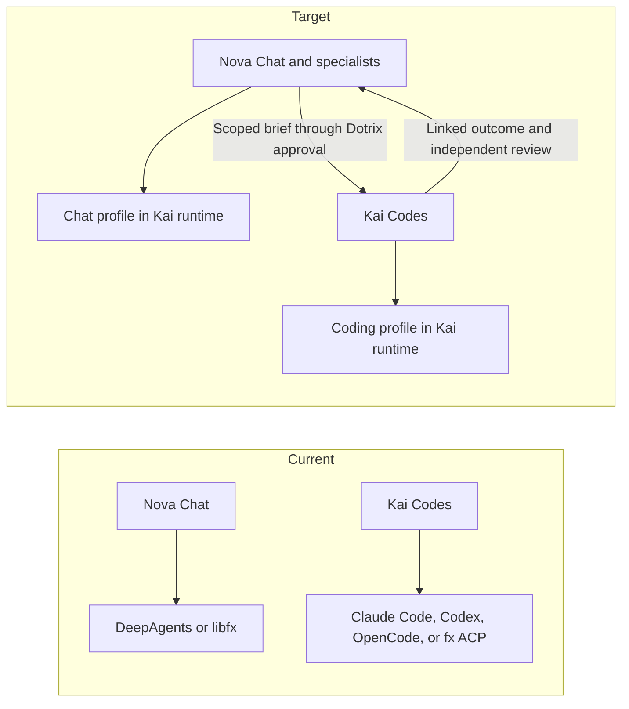

# Dotrix migration to Kai

Current baseline decision: use [fx v0.0.17 plus the upstream printf backport](DOTRIX_KAI_RELEASE_BASELINE.md). This supersedes the development-snapshot qualification approach recorded below. Revalidate implementation inventories against the release-based branch before changing code; the rollout and state-preservation requirements still apply.

## Current execution order

Updated at the user's direction on 18 November 2026. Branding is the final phase. Keep `fx`, `libfx`, `FX_*`, `.fx`, and existing stored runtime identifiers during the functional migration. The older numbered sections below retain their implementation detail; this table controls their execution order.

| Phase | Work | Evidence required before dependent rollout |
| --- | --- | --- |
| 0 | Start from released v0.0.17 with only the upstream printf repair. | Focused regression, shell parity, successful build, and real built-binary interaction; record the narrower qualification scope. |
| 1 | Map the shared execution contract and prove SDK/journal compatibility. | Deterministic published-version fixtures, preserved host tools/approvals, cancellation and resume contracts, and a recorded gap list. Reuse SDK and ACP where they already satisfy the contract. |
| 2 | Verify provider/model capabilities and separate Chat/Coding policies. | Scoped tools, explicit unsupported capabilities, and deterministic streaming/tool/error/cancellation checks. Preserve host-owned credentials and authorization. |
| 3 | Replace Dotrix Chat's libfx 0.0.16 package with the selected fork build for new work. | Compatible package resolution and runtime binding, saved-state policy, Nova/specialist approval and recovery checks, and real host interaction. Keep versioned artifacts for existing sessions. |
| 4 | Move cloud coding and then native local execution to the same fork revision. | ACP compatibility, isolated worktree and relay, cancellation, state restoration, supported-host checks, and linked outcomes. |
| 5 | Extend bounded delegation, skills and browser tooling where the capability audit finds gaps. | Narrowed child authority, versioned skill policy, controlled browser execution, durable milestone attribution, and deterministic Playwright evidence. |
| 6 | Verify full journeys and retire legacy admissions after parity and rollback. | Separate Chat/Codes histories, independent Juno review, current-commit evidence, model coverage, and preserved active-session recovery. |
| 7 | Apply Kai branding and final distribution names. | Tested aliases/import policy, private package/native loader alignment, preserved saved formats, attribution, and compatibility checks across the renamed surfaces. |

Dotrix Chat 0.0.16 is historical input for state compatibility, not the runtime for new chats after migration. Private artifact access can be established under transitional names before phase 3; it must not trigger a broad rename. No publication or deployment is implied by preparing these changes. **R1.4, R3.3, R3.5, R4.1, R4.8, R5.4, R7.3, R7.6, R8.2.**

### Phase 1 execution contract

| Operation | Chat | Codes |
| --- | --- | --- |
| Admit and start | Dotrix resolves role, provider, tool scope, and pinned runtime before opening the SDK session. | Dotrix approves the brief and starts an isolated worker before ACP `session/new`. |
| Submit and observe | The SDK prompt uses a stable turn ID. Dotrix projects SDK events into its private run stream. | The worker sends ACP `session/prompt` and projects `session/update` into the coding run. |
| Stop | Dotrix invokes SDK cancellation and reconciles pending inputs under the run lease. | The worker sends ACP cancellation and owns termination and cleanup. |
| Recover | Dotrix reacquires the lease and resumes through the pinned journal reader. Tool execution IDs remain linked to the host ledger. | The worker restores the pinned environment and state, then resumes the recorded ACP session. |
| Approve and hand off | Dotrix owns the decision and passes approved effects through its existing tool handlers. | The worker receives a scoped brief and publishes a linked outcome through Dotrix policy. |

Use the existing SDK and ACP adapters for this phase. Add a shared transport or event field only when a verified consumer needs it. Preserve identifiers across retries and distinguish stream loss from cancellation. **R1.4, R1.8, R2.4, R3.3, R3.6, R6.3.**

Move Dotrix Chat and Codes to one private Kai runtime. Nova leads Chat with Lyra, Orion, Vega, Juno, and Echo as named specialists. Kai leads Codes in a separate session and isolated worktree. Dotrix owns approvals, model policy, personal provider credentials, scheduling, task state, and audit. Kai runs turns, tools, and session-local recovery.

## Starting revisions

| Surface | Recorded baseline |
| --- | --- |
| Private Kai repository | `adeyemiadekunle/kai-runtime`, default branch `main`. It contains the release baseline `5356f7fee` and the compatibility tests merged at `9305e3d74`. |
| Upstream | `vercel-labs/fx` at the `v0.0.17` tag, with the printf repair backported. The former `kai-engine` repository is archived. |
| Dotrix | GitHub `stage` and local `origin/stage` matched at `b039f6cfa47abaaec5aa6a6f31470491413f524c` when the audit started. |
| Dotrix Chat | DeepAgents and the fx slot, which pins `libfx@0.0.16` in `packages/engine/src/dotrix_engine/runtimes/fx_host/`. |
| Dotrix Codes | Claude Code, Codex, OpenCode, and the fx slot. The coding image pins fx `0.0.17` and drives it through `infra/coding/fx-acp.mjs`. |

Use Dotrix Plan 046 for the existing integration points. The slot swap is an intermediate milestone on the way to retiring the legacy engines. [Runtime direction](KAI_DOTRIX_NEW_DIRECTION.md)

The [Dotrix integration audit](DOTRIX_KAI_INTEGRATION_AUDIT.md) maps the current `stage` source to migration changes, state compatibility, verification owners, and rollout gates. It also records drift from the earlier local checkout and Plan 046.

## 0. Verify the baseline

1. Record the exact private Kai, upstream fx, and Dotrix `stage` SHAs and the upstream comparison. Use the private `fx-baseline` branch as the starting point. Keep upstream sync in reviewed PRs. The inherited release workflow runs on pushes to `main`, so review and disable inherited publishing before promoting the baseline.
2. Inventory the CLI, configuration and data paths, SDK exports, ACP, provider adapters, permissions, tools, skills, subagents, and recovery. Map each capability to its owner, current tests, and any gap relevant to Dotrix.
3. Pin the exact Zig toolchain used by CI. The baseline specifies a minimum of Zig 0.17.1. Build, check formatting and module boundaries, and run focused Zig and Bun tests with `FX_SOUND=0` for Bun. Exercise a deterministic model turn, tool call, and session resume using the freshly built binary from the checkout. Record exit status and stderr, and collect Linux and macOS arm64 CI results for the exact SHA.
4. Record comparable baseline workloads and results for task success, latency, memory, tool calls, and recovery. Use the same workloads to evaluate Kai before changing defaults.

Advance when the capability inventory and baseline checks are recorded. **R1.1, R1.4, R7.3, R7.5, R7.6.**

[Baseline capability audit](DOTRIX_KAI_BASELINE.md)

## 1. Brand and package the runtime

1. Remove inherited publishing destinations in a dedicated PR. Preserve validation CI, fx attribution, licenses, and notices.
2. Produce the `kai` executable. Map Kai-owned controls from `FX_*` to `KAI_*`, `~/.fx` to `~/.kai`, and `.fx.json` to `.kai.json`. Apply the `fx-cli-shape` skill, document alias precedence and retirement, and keep ACP payloads and SDK exports compatible.
3. Test idempotent import of eligible legacy state. Keep original files and test interrupted imports, conflicting destinations, and unsupported versions. Keep old readers available where retained state requires them.
4. Build the Chat SDK and Codes binary from the same reviewed SHA. Confirm the private registry, package scope, and CI credential path before publishing. Pin the coding image source commit and Zig toolchain. Use build-time credentials and keep them out of the image and worker environment. Record the Kai SHA, SDK version, and coding image digest together.

Advance when CI can install the private artifact and the built `kai` binary passes a deterministic model turn, an approved tool call, and a session resume. **R3.4, R3.5, R4.7, R4.8, R5.1, R5.3, R5.4, R7.6, R8.2.**

## 2. Replace the existing fx slots in Dotrix

### Chat

1. Pin the private SDK in `runtimes/fx_host/`. Update imports, the dependency check, the configuration fingerprint, and the runtime binding in `modules/agents/fx_pilot.py`. Preserve existing approvals, specialist attribution, steering, queued inputs, and lease and journal fencing.
2. Test journals from the deployed libfx version with the real Kai build. Drain or route incompatible active runs to the original runtime. Reconcile any pending writes before restarting work.
3. Run `test_fx_changes.py`, `test_chat_inputs.py`, `test_runtime_tools.py`, and `test_specialist_continuity.py`. Verify a real Nova turn with a deterministic provider, a named specialist, an approval and denial, and killed-worker recovery.

### Codes

1. Build Kai in the coding image from a pinned revision. Adapt `infra/coding/fx-acp.mjs` and the state paths. Inventory both native and cloud launch paths on `stage`. Preserve stored `CodingAgent.FX` and deployment-facing control names during the pilot.
2. Verify ACP compatibility, provider relays, scoped credentials, worktree isolation, and refusal when isolation cannot be established. Test old state for a safe resume or an actionable recovery path using the original worker.
3. Run `test_fx_coding.py` and both `test_coding.py` suites. Drive a real coding turn through the built Kai binary and the Dotrix ACP driver. Exercise cancellation and resume and verify that diffs and test evidence attach to the right task.

Land Chat and Codes independently, with a tested rollback pin for each. **R1.4, R2.4, R3.3, R3.6, R3.9, R4.1, R4.2, R4.3, R4.8, R5.3, R7.1, R8.2.**

## 3. Make Kai the default and retire legacy engines

1. Exercise the full Dotrix journey. Nova proposes a scoped coding brief, Dotrix applies the permission and approval policy, and Kai works in the isolated session. Verify the link back to Chat, including Juno's independent review where applicable. Cover denied actions, interruption, restart, and preservation of pending approvals.
2. Compare supported models and worker types using fixed tasks. Decide acceptance thresholds against the baseline before reviewing the pilot. Measure quality, latency, cost, recoverability, and human intervention.
3. Roll out an internal opt-in first, then default new sessions to Kai. Preserve model selection and keep active work on its recorded runtime binding.
4. Rehearse rollback before broad rollout. Restore routing for new work and use the recorded runtime and original state to drain or recover active runs. Stop affected admissions if approvals, isolation, or journals regress. Reconcile unknown tool outcomes before retrying.
5. Retire legacy adapters and selectors once parity and rollback pass and the team accounts for every active session and retained journal.

Require a successful build, focused tests, CI for the exact Kai commit including macOS arm64, and real Chat and Codes interactions through the built artifacts. Record stderr, exit status, and the rollback result. Classify new root Kai E2E files in the PGSO corpus, assign CI shard weights, and update any affected TLA+ model. **R3.3, R3.4, R3.5, R3.6, R7.2, R7.3, R7.5, R7.6, R8.4.**

## Skills and browser follow-up

Audit existing skill and browser integration during phase 0. After slot parity, pilot a Dotrix-owned registry over pinned `SKILL.md` content and a sandboxed Agent Browser adapter. Keep Playwright for deterministic regression tests. [Skills and browser architecture](DOTRIX_KAI_SKILLS_BROWSER_ARCHITECTURE.md)
