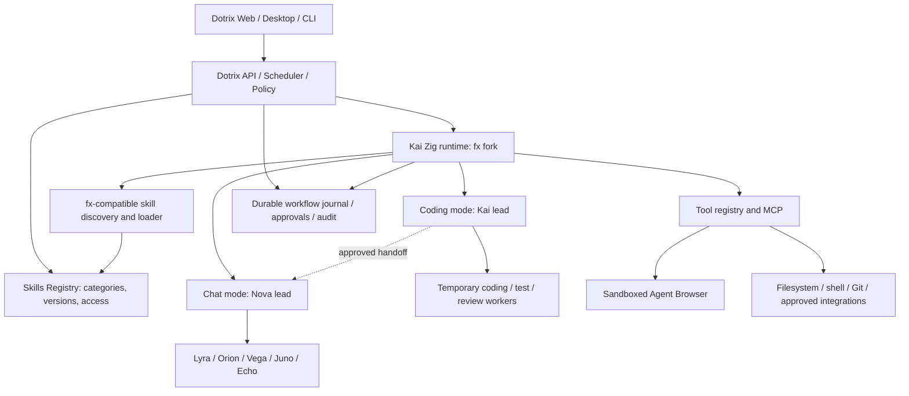

# Dotrix + Kai: Skills Registry and Browser Agent Architecture

**Status:** Proposed technical direction  
**Date:** 17 November 2026  
**Repositories:** [Dotrix](https://github.com/adeyemiadekunle/dotrix) · [Kai](https://github.com/adeyemiadekunle/kai-runtime)  
**Related:** `KAI_DOTRIX_NEW_DIRECTION.md`

## 1. Executive decision

Dotrix will provide a category-based Skills Registry and browser execution capabilities. Kai, the internal Zig runtime forked from fx, executes both Chat and Coding workflows. **Nova leads Chat** and coordinates Lyra, Orion, Vega, Juno and Echo; **Kai leads Coding**. They use separate session contexts, permissions and interfaces, with structured handoffs.

**Decisions:**
- Reuse fx's existing `SKILL.md` discovery/loading mechanisms wherever possible; verify behavior against the pinned Kai fork commit before extending.
- Dotrix owns skill catalogue metadata, categories, enablement, trust, version pins, agent policy, and UI; Kai owns runtime discovery, loading, tool calls, and execution events.
- Integrate [Agent Browser](https://agent-browser.dev/introduction) as a sandboxed browser tool for agent-driven interaction, inspection, screenshots, and exploratory verification.
- **Retain Playwright** for deterministic E2E tests and CI. Agent Browser is not categorically faster or better: benchmark on Dotrix tasks.
- Start with [Google Modern Web Guidance](https://github.com/GoogleChrome/modern-web-guidance-src) and selected compatible material from [Anthropic Knowledge Work Plugins](https://github.com/anthropics/knowledge-work-plugins). Audit licences, dependencies and security before bundling.

## 2. Architectural boundaries



A Chat-to-Coding handoff is **not** shared mutable conversation state. It is a structured task with an origin chat ID, destination coding session ID, scope, approval mode, context references and results. Nova does not micromanage Kai's temporary coding workers.

## 3. Skills taxonomy

Use **one primary category** per skill and multiple searchable tags. Suggested initial catalogue:

| Category | Example skills | Likely agents |
|---|---|---|
| Frontend | Modern Web Guidance, accessibility, React/Next.js, responsive UI, performance | Kai, Orion, Juno |
| Backend | API design, FastAPI, database design, caching | Kai, Orion |
| Architecture & System Design | ADRs, distributed systems, scalability, threat boundaries | Orion, Nova, Kai |
| Security | OWASP, threat modelling, secure coding, dependency review | Juno, Orion, Kai |
| Testing & QA | Browser verification, E2E, unit testing, code review | Juno, Kai |
| Browser & Automation | Navigation workflows, screenshots, browser evidence | Kai, Vega, Juno |
| DevOps | Docker, CI/CD, deployment, observability | Kai, Orion |
| Research & Data | Evidence evaluation, technical research, analysis | Vega, Nova |
| Product & UX | Requirements, user stories, interaction design | Lyra, Nova |
| Documentation | Technical writing, release notes, API docs | Echo, Orion |

Categories improve discovery; they do not automatically grant tool access. Agent assignments are defaults subject to project and organisation policy.

## 4. Skill representation and compatibility

Preserve upstream `SKILL.md` files and progressive disclosure: show short descriptions first, then load the full skill only on demand. **Do not assume** that fx automatically recurses through nested category folders; verify actual discovery roots in the pinned fork. For an initial compatible layout, use flat skill directories and classify them in Dotrix metadata:

```text
kai/
  .fx/skills/
    frontend-modern-web-guidance/SKILL.md
    frontend-accessibility/SKILL.md
    backend-api-design/SKILL.md
    security-threat-modelling/SKILL.md
    testing-browser-verification/SKILL.md
  dotrix/  # Proposed extension boundary, subject to code audit
    skill_registry.zig
    skill_policy.zig
    skill_events.zig
```

Proposed registry metadata (not an fx-native manifest):

```yaml
id: frontend-modern-web-guidance
name: Modern Web Guidance
category: frontend
tags: [web, accessibility, performance]
source:
  repository: https://github.com/GoogleChrome/modern-web-guidance-src
  revision: <pinned-reviewed-commit>
trust: reviewed
allowed_agents: [kai, orion, juno]
activation: on_demand
required_tools: [read_files]
version: 1.0.0 # internal registry version, not upstream version
```

Use a separate Dotrix metadata file or database table; don't break imported skill files. Canonical identifiers should remain stable across updates. Track `source_revision`, checksum, approval date, owner, licence, runtime requirements, deprecation status and last validation result.

### Skill lifecycle

1. **Discover** from approved skill roots or an explicit import.
2. **Inspect** manifest, files, scripts, dependencies, network needs and licence.
3. **Classify** into one category and multiple tags.
4. **Approve and pin** an immutable source revision; scan for prompt injection and unsafe commands.
5. **Enable** for workspace/project/agent scope.
6. **Match** a task to candidate skill descriptions; apply allowlists before showing to the model.
7. **Load** full instructions only when selected; record skill ID and revision in the execution journal.
8. **Execute** tools only through independent permission checks.
9. **Audit, update or revoke** with rollback support.

Do not auto-run `npx ...@latest` in production sessions. Use an audited, pinned build-time installation or reviewed skill bundle.

## 5. Source integrations

### 5.1 Google Modern Web Guidance

Source: https://github.com/GoogleChrome/modern-web-guidance-src

Initial development experiment:

```bash
npx modern-web-guidance@latest install
```

Run only in a disposable developer environment to inspect what is installed. Then pin and review a specific release/commit and dependencies. Verify its actual install paths, search interface, and `SKILL.md` compatibility with Kai's pinned fx implementation. Use it for accessibility, modern browser APIs, compatibility and performance guidance; do not mistake recommendations for automated verification.

### 5.2 Anthropic Knowledge Work Plugins

Source: https://github.com/anthropics/knowledge-work-plugins

Import **selected compatible skills**, not whole plugin packages blindly. Claude-specific commands, hooks, connectors, configuration, or tool names may need adapters or may be unsupported. Preserve attribution and comply with each relevant licence. Suggested first pilots: product requirements (Lyra), architecture/research (Orion/Vega), documentation (Echo), review (Juno). Map external tool requirements explicitly; a skill's text must never grant credentials or shell permissions.

### 5.3 Agent Browser

Source: https://agent-browser.dev/introduction

Treat Agent Browser as an **executable tool**, not merely a `SKILL.md` file. A companion browser skill may teach agents its command workflow. Kai can call a managed Agent Browser subprocess from Zig; initially avoid writing a native Zig browser automation implementation.

Potential command workflow (confirm syntax against the pinned installed version):

```bash
agent-browser open http://localhost:3000
agent-browser snapshot -i
agent-browser screenshot page.png
```

The browser adapter should expose typed operations rather than unrestricted shell commands, e.g. `browser.open`, `browser.snapshot`, `browser.click`, `browser.fill`, `browser.screenshot`, `browser.close`. Validate references, URLs, output paths, timeouts and allowed operations.

## 6. Agent Browser versus Playwright

**Verdict:** Different strengths. Do not assert Agent Browser is universally better or faster without measuring equivalent tasks.

| Dimension | Agent Browser | Playwright |
|---|---|---|
| Agent-driven exploratory navigation | Good fit: CLI and agent-oriented snapshots | Possible with an adapter or generated scripts |
| Repeatable regression suites | Possible, but requires careful orchestration | Strong established test runner, assertions, fixtures, traces |
| CI and deterministic checks | Needs integration discipline | Preferred default |
| Screenshots and browser inspection | Yes | Yes |
| Natural-language agent workflows | Convenient CLI tool interface | Requires agent tooling layer |
| Raw browser speed | Must benchmark | Must benchmark |
| Reliability | Depends on agent, environment and selector strategy | Strong for scripted, deterministic tests |
| Security | Requires sandbox, domain and data policies | Requires sandbox, domain and data policies |

Agent Browser's implementation may use browser automation infrastructure underneath; comparing the CLI against Playwright's test runner is not a like-for-like engine benchmark. For Dotrix, use **Agent Browser for autonomous exploration and feedback** and **Playwright for committed E2E regression tests**. Kai may generate a Playwright test after exploratory discovery, but the test must be reviewed and rerun deterministically.

### Benchmark protocol

Run both on the same application, machine/worker class, browser version, network conditions and test scenario. Measure: time to first interaction, total task duration, successful completion, number of model turns, token usage, tool calls, memory, flakiness across 10+ runs, screenshot/artifact size, and recovery after forced interruption. Include scenarios: login, navigation, multi-step form, dynamic loading, error handling, responsive layout, and permission-denied action. Report confidence intervals or at least medians and failure counts. Do not fabricate results.

## 7. Browser security and execution policy

- Run browsers in isolated workers/containers with per-execution profiles, temporary storage and controlled egress.
- Restrict domains and network access; block cloud metadata services and internal/private network targets unless explicitly authorised.
- Keep cookies, credentials and user data scoped to the correct user, workspace and execution; redact secrets from logs and screenshots where possible.
- Require approval for purchases, destructive actions, external submissions, account changes, and sensitive data transmission.
- Treat page text, downloaded files and skill instructions as untrusted; protect against prompt injection.
- Apply resource limits: memory, CPU, runtime, tab count, download size, parallel sessions and output size.
- On cancellation, terminate browser processes, clean temporary profiles and preserve permitted evidence.
- Store screenshots and snapshots as access-controlled artifacts with retention rules.

Browser permissions are enforced by Dotrix and Kai's tool boundary, not by agent prompts.

## 8. Durable execution and event model

Dotrix owns workflow state; Kai owns execution-local state. Persist task IDs, session IDs, parent/child execution IDs, model/provider selection, skill versions, tool invocations, browser session identifiers, approval requests, checkpoints, artifacts and outcomes.

Suggested events:

```text
skill.discovered
skill.selected
skill.loaded
skill.rejected
browser.session.started
browser.navigation.completed
browser.snapshot.created
browser.screenshot.created
browser.action.failed
browser.session.closed
execution.checkpointed
execution.resume.requested
approval.required
execution.cancelled
```

Each event should include `event_id`, `execution_id`, `parent_execution_id` (if any), `session_id`, timestamp, attempt number and relevant artifact references. Use idempotency keys for operations that might be retried. **Do not replay browser clicks, form submissions, purchases or other side effects automatically after a crash.** Reconcile actual browser state or request approval first. Checkpoints should include a safe resume strategy, not pretend that a browser process can always be restored byte-for-byte.

Subagents receive bounded concurrency, a scoped tool allowlist, an independent context, a parent execution ID and a cancellation signal. Nova's named specialists are distinct from Kai Coding's temporary workers.

## 9. Dotrix user experience

A dedicated **Skills** page should provide category navigation, search, provenance, version, trust status, enable/disable controls, assigned agents, required tools and validation history. Users may choose a skill manually; Nova/Kai may recommend one automatically when policy allows. Show **why a skill was selected** and which version was used.

A **Browser** activity panel in Codes should show current URL/domain, safe action timeline, snapshots, screenshots, errors, approvals and links to resulting tests. Chat may expose browser-assisted research only under its own limited policy; Chat must not silently inherit Coding's full filesystem and terminal privileges.

## 10. Example end-to-end scenario

**Request:** “Nova, plan and build a secure, accessible Next.js dashboard and verify it in a browser.”

1. Nova consults Lyra for requirements and Orion for architecture; optionally Vega for research.
2. Dotrix creates an approved handoff with acceptance criteria, references and permission scope.
3. Kai Coding starts a separate session and isolated worktree.
4. Kai discovers frontend, security and testing skills; loads Modern Web Guidance only when relevant.
5. Kai edits code and runs unit/build checks using permitted tools.
6. Kai launches Agent Browser in an isolated worker, inspects the UI, captures screenshots and reports failures.
7. Kai writes or updates deterministic Playwright E2E tests for important verified paths and runs them in CI.
8. Juno reviews diffs, security concerns, tests and browser evidence.
9. Dotrix records artifacts and outcome; Nova summarises the result in the original Chat session.

## 11. Phased implementation backlog

### Phase 0 — Audit (P0)
- [ ] Pin the Kai fork commit and fx upstream baseline.
- [ ] Inspect actual skill roots, discovery depth, `SKILL.md` parser, toolbox and skill-loading API.
- [ ] Inspect fx subagent tool scoping, session persistence, cancellation and recovery contracts.
- [ ] Record the current Dotrix Nova/Kai permissions and handoff boundaries.
- [ ] Verify licences and packaging requirements for all three external projects.

### Phase 1 — Registry MVP (P0)
- [ ] Define categories, tags, skill IDs and registry metadata schema.
- [ ] Add source revision, checksum, approval state and workspace/agent policy.
- [ ] Index existing fx-compatible skills without changing their source format.
- [ ] Implement lazy skill loading and version recording per execution.
- [ ] Test duplicate names, invalid manifests, missing dependencies and denied access.

### Phase 2 — Initial knowledge skills (P1)
- [ ] Trial Modern Web Guidance in a disposable environment.
- [ ] Pin, inspect and package the approved guidance bundle.
- [ ] Import one compatible Anthropic knowledge skill as a pilot.
- [ ] Validate agent-to-skill mapping for Nova, Orion, Lyra, Vega, Juno, Echo and Kai.
- [ ] Add Skills UI with search, categories and trust information.

### Phase 3 — Browser tool MVP (P1)
- [ ] Pin Agent Browser binary/version and install in a dedicated worker image.
- [ ] Implement typed browser adapter and event streaming in Kai.
- [ ] Enforce domain, network, credential, approval and sandbox policies.
- [ ] Support snapshots, screenshots, cancellation and artifact retention.
- [ ] Test browser failures, process crashes, timeouts and cleanup.

### Phase 4 — Verification and durability (P1)
- [ ] Connect browser evidence to Kai Coding and Juno review.
- [ ] Preserve Playwright E2E workflows and CI checks.
- [ ] Add idempotent journaling, checkpoint/resume and side-effect reconciliation.
- [ ] Add per-task budgets and bounded subagent/browser parallelism.
- [ ] Benchmark Agent Browser versus Playwright on comparable Dotrix scenarios.

### Phase 5 — Rollout (P2)
- [ ] Pilot with a small set of trusted skills and users.
- [ ] Instrument task success, cost, latency, tool errors and security denials.
- [ ] Add policy-controlled skill updates, rollback and deprecation.
- [ ] Expand categories only after usage and validation evidence.

## 12. Acceptance gates

**Skills:** Existing fx skills still load; invalid or unauthorised skills fail closed; on-demand loading does not inflate all sessions' context; execution logs pin the exact skill revision.

**Browser:** Browser actions are scoped to approved targets; screenshots and snapshots are attributable; cancellation cleans up processes; sensitive actions require approval; browser failures do not corrupt the parent session.

**Agent workflow:** Nova coordinates specialists in Chat; Kai leads Coding; handoffs preserve separation; Juno can independently review; retries do not repeat side effects; child execution IDs and artifacts remain traceable.

**Testing:** The changed Zig runtime builds and passes focused tests; CI passes on supported platforms; a real binary interaction is exercised; browser and E2E flows are run end to end. Do not declare readiness from unit tests alone.

## 13. Risks and mitigations

| Risk | Mitigation |
|---|---|
| Upstream fx changes break the fork | Pin baseline, keep Dotrix extensions isolated, maintain compatibility tests |
| Skill imports contain unsafe instructions/scripts | Review, scan, pin, sandbox and enforce independent tool permissions |
| Too many skills increase tokens and confusion | Description-only discovery, relevance ranking, lazy load, limits |
| Browser sessions leak data | Isolated profiles, workspace scoping, secret redaction, retention |
| Browser automation is flaky | Retry only safe operations; deterministic Playwright regression coverage |
| Multi-agent work explodes in cost | Concurrency limits, budgets, explicit delegation criteria |
| Recovery repeats side effects | Idempotency journal, reconciliation and human approval |
| Plugin ecosystem assumes Claude-specific APIs | Import skills selectively and adapt only verified compatible capabilities |

## 14. Explicit non-goals

- No standalone commercial Kai product or public SDK requirement.
- No replacement of Playwright solely because Agent Browser is agent-friendly.
- No automatic installation of unreviewed remote skills during user sessions.
- No grant of shell, browser, network or secrets access from a skill's prose.
- No merging of Chat and Coding histories or permission scopes.
- No hardcoding each Dotrix specialist as a separate Zig agent engine.

## 15. References

- [Kai fork](https://github.com/adeyemiadekunle/kai-runtime)
- [Dotrix](https://github.com/adeyemiadekunle/dotrix)
- [fx documentation](https://fx.sh/docs)
- [fx skills](https://fx.sh/docs/capabilities/skills)
- [Google Modern Web Guidance](https://github.com/GoogleChrome/modern-web-guidance-src)
- [Anthropic Knowledge Work Plugins](https://github.com/anthropics/knowledge-work-plugins)
- [Agent Browser](https://agent-browser.dev/introduction)
- [Playwright documentation](https://playwright.dev/docs/intro)

---

**Implementation principle:** Dotrix decides **who may do what**; Kai/fx provides **how agents execute**; skills supply **task-specific knowledge**; browser tools supply **controlled interaction**; Playwright supplies **repeatable regression evidence**.
