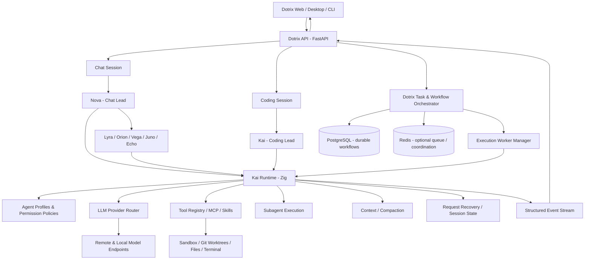
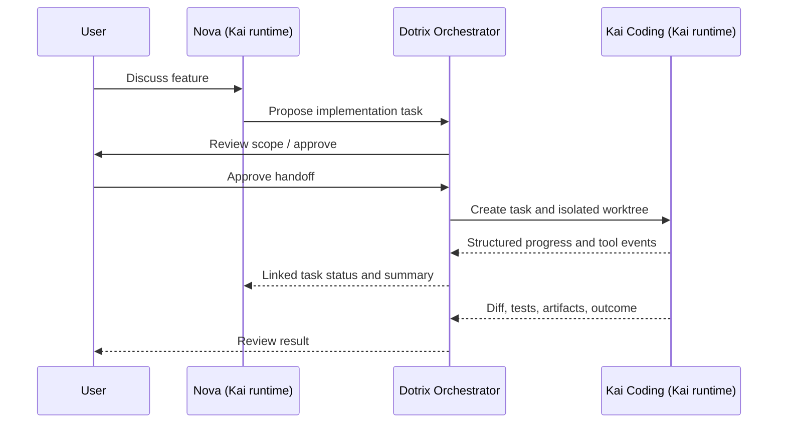
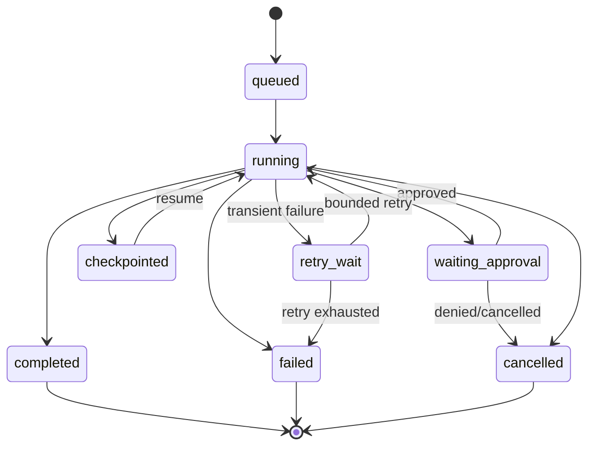
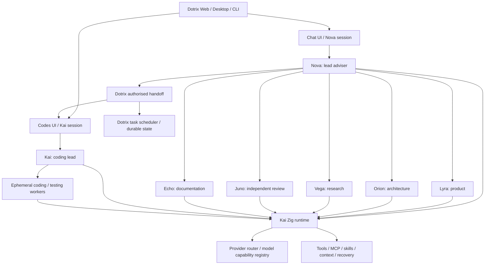
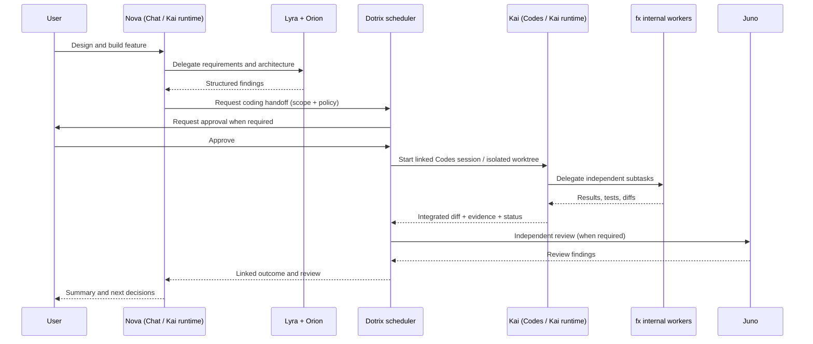

# Kai — Dotrix Internal Agent Engine

**Status:** Revised proposed architecture and implementation roadmap (Nova team integration)  
**Date:** 16 November 2026  
**Repositories:** [Kai](https://github.com/adeyemiadekunle/kai-runtime) · [Dotrix](https://github.com/adeyemiadekunle/dotrix)  
**Origin:** Kai is a maintained fork of the Zig-based fx agent.  
**Scope:** Kai exists exclusively as Dotrix's internal chat and coding agent runtime; it is not an independent product.

## 1. Executive decision

Dotrix will converge from multiple independent chat/coding agent engines (Deep Agents, libfx, Codex, Claude Code, OpenCode, and fx) onto **Kai**, a Dotrix-owned, Zig-based agent runtime derived from fx. The user-facing **Chat** and **Coding** experiences remain separate, but both execute through Kai with distinct profiles, permissions, tools, and context policies. Chat can hand approved work to Coding without moving the entire conversation or exposing coding permissions to Chat. **Nova leads Chat; Kai leads Coding.** Both execute through the same Zig runtime. The existing fixed Dotrix team—Nova, Lyra, Orion, Vega, Juno, Echo, and Kai—must be preserved.

This is an architectural direction, **not a claim that all listed capabilities are already implemented**. Existing fx facilities must be inventoried and tested before deciding whether to extend, adapt, or replace them. Model quality, tool reliability, safety, recovery, and user experience take precedence over theoretical Zig performance gains.

### Goals

1. Own one internal agent execution core and reduce adapter maintenance.
2. Preserve multi-model choice without tying the runtime to any one provider.
3. Reuse fx's existing agent loop, subagents, tool infrastructure, MCP, skills, context compaction, sessions, and recovery where suitable.
4. Make coding work observable, cancellable, resumable, auditable, and permission-aware.
5. Support local desktop and isolated cloud execution using the same Kai runtime contract.
6. Enable collaboration among humans and AI agents while keeping Dotrix authoritative for task ownership and workflow state.

### Non-goals

- Building a separately marketed Kai platform, public marketplace, or general-purpose public SDK.
- Rewriting Dotrix's FastAPI business backend in Zig.
- Combining Chat and Coding into one unrestricted session or prompt history.
- Guaranteeing that every model supports every tool, modality, or structured output feature.
- Replacing established coding engines before Kai passes comparative evaluations.

## 2. Architecture and ownership



**Dotrix owns:** users, organizations, authentication, RBAC, workspace membership, projects, tasks, human-agent assignment, approvals, scheduling, billing, canonical task state, audit retention, and execution placement.

**Kai owns:** model interaction, agent turns, agent profiles, prompt/context assembly, tool invocation, subagent execution within a task, streaming agent events, session-local state, request-level recovery, and execution checkpoints.

**Workers own:** isolated process/container lifecycle, workspace mounts, Git worktrees, resource limits, filesystem and network boundaries, process termination, and artifact collection. Kai must not be trusted as the only security boundary.

Use a **single logical Kai runtime implementation**, not necessarily one long-lived OS process for all tenants. Prefer isolated Kai processes per execution/security boundary, especially in the cloud.

## 3. Phase 0 — Audit and baseline before modifying fx

The current Kai fork's `AGENTS.md` describes Zig 0.17+, `src/main.zig` as composition root, `src/core/agents/` for conversation state, `src/core/recovery/` for request recovery, `src/core/compactor/` for context compaction, and an independent `sdk/` directory. Treat these as starting points, not proof of production readiness.

- [ ] Record the exact Kai commit and upstream fx commit; produce a fork diff.
- [ ] Inventory CLI commands, binary names, config keys, environment variables, storage paths, docs, tests, release scripts, and platform targets.
- [ ] Inspect actual agent-loop, subagent, provider, MCP, skills, tool, session, recovery, and SDK APIs.
- [ ] Map every capability to **reuse / extend / replace / not present** with source paths and tests.
- [ ] Capture baseline build time, startup time, RSS, tool-call latency, session recovery, and coding-task success.
- [ ] Run `zig build`, `zig build test`, formatting checks, relevant Bun E2E tests, and a real binary interaction where the environment permits.
- [ ] Verify CI on Linux and macOS arm64 for the exact commit; document any platform gaps.

**Exit gate:** a written capability inventory and passing baseline on supported targets. Do not begin a sweeping rename while the baseline is red.

## 4. Phase 1 — Rebrand fx to Kai safely

Branding is a standalone, reviewable migration. Preserve functionality and existing public-facing behavior until compatibility and migration are tested.

### 4.1 Naming policy

| Surface | Target |
|---|---|
| Product/runtime name | Kai |
| CLI executable | `kai` |
| CLI examples and help | `kai ...` |
| Internal integration package | Dotrix-scoped Kai adapter; exact package name chosen during implementation |
| Default user config/data directories | Kai-specific paths, with documented migration |
| Environment variables | `KAI_*` for Kai-owned settings |
| User-facing agent identity | Kai |
| Upstream attribution | Preserve fx origin, license, notices, and credits |

Do not globally replace the string `fx`: it may appear in dependency names, tests, wire protocols, identifiers, fixture data, upstream URLs, or compatibility code where changing it would be incorrect.

### 4.2 Ordered migration checklist

- [ ] Create a `branding/kai` branch and baseline snapshot.
- [ ] Define canonical naming in one central constants/configuration layer.
- [ ] Update binary output, CLI help, version strings, welcome text, errors, and session display names.
- [ ] Update build targets, packaging, install/uninstall scripts, release assets, and CI artifact names.
- [ ] Migrate config and data paths with explicit one-time import, backups, and idempotent migration markers; never silently overwrite user data.
- [ ] Decide whether legacy `FX_*` environment variables and `fx` executable alias are temporarily supported. If supported, document precedence and removal date.
- [ ] Update SDK entry points, examples, developer docs, `AGENTS.md`, and code references only where semantics change.
- [ ] Update snapshots and fixtures intentionally; do not blindly approve snapshot changes.
- [ ] Run static search for `fx`, `libfx`, old paths, install URLs, binary names, and version strings; classify remaining references.
- [ ] Build and test across supported OS/architectures, then run the **newly built `kai` binary** end to end.
- [ ] Preserve upstream license/attribution and verify dependencies' redistribution obligations.

**Exit gate:** `kai` installs, starts, performs a model turn, invokes an approved tool, resumes a session, and exits cleanly. Old state migrates or fails with a clear recovery path. No accidental protocol breakage.

## 5. Phase 2 — Internal Kai runtime contract

Build the **smallest stable internal interface** Dotrix needs. Choose one primary transport after benchmarking: local IPC/stdio for desktop and worker use, or a secured network protocol for remote workers. Avoid maintaining multiple full implementations unnecessarily.

### Commands

| Command | Purpose |
|---|---|
| `create_session` | Create session with project, profile, model policy, and execution context |
| `send_message` | Submit input with idempotency key |
| `stream_events` | Subscribe/replay events from cursor |
| `get_session_state` | Retrieve durable state and active execution |
| `cancel_execution` | Request cancellation and terminate worker-side activity safely |
| `resume_session` | Resume after interruption using stored checkpoint |
| `submit_approval` | Approve/deny a pending scoped tool action |
| `handoff_task` | Request Dotrix to create a coding task from Chat; Dotrix authorizes it |

### Common envelope

```json
{
  "schema_version": 1,
  "event_id": "evt_123",
  "execution_id": "exec_123",
  "session_id": "session_123",
  "task_id": "task_123",
  "sequence": 42,
  "type": "tool.completed",
  "timestamp": "2026-11-16T12:00:00Z",
  "payload": {}
}
```

Event types: `session.created`, `agent.started`, `agent.message.delta`, `agent.message.completed`, `model.usage`, `tool.started`, `tool.completed`, `tool.failed`, `subagent.started`, `subagent.completed`, `approval.required`, `approval.resolved`, `checkpoint.saved`, `execution.resumed`, `execution.cancelled`, `agent.completed`, `agent.failed`.

Require monotonic sequence numbers per execution, replay from cursor, explicit terminal states, versioned schemas, and event deduplication. Stream tokens for UI responsiveness, but persist durable milestones rather than every transient token if costs are excessive. Never interpret a lost stream as proof that execution stopped.

## 6. Phase 3 — Multiple LLM models and providers

**Principle:** Kai is the agent runtime; the LLM is a replaceable inference dependency. Provider support should be based on tested adapters and capabilities, not a hardcoded claim of universal compatibility.

### Target integrations

- OpenAI API and compatible endpoints.
- Anthropic API.
- Google Gemini API.
- OpenRouter or another model-routing endpoint.
- Local inference through compatible endpoints (for example Ollama or LM Studio, depending on protocol support).
- Additional providers through a well-defined adapter, subject to testing.

### Provider abstraction

```text
ModelProvider
  list_models()
  get_capabilities(model)
  stream_response(messages, tools, settings)
  normalize_tool_calls()
  normalize_usage()
  classify_error()
  estimate_cost_if_pricing_available()
```

Define per-model capabilities: context window, maximum output, tool calling, parallel tool calls, vision, reasoning controls, structured output, prompt caching, and supported authentication. An unknown capability must not be treated as supported.

**Routing policy:** user-selected model by default; optional Dotrix policy-based selection for task type, budget, or capability. Automatic fallback is opt-in or policy-controlled, never silently changes data residency or security guarantees. Before fallback, assess whether the previous model request already produced tool effects. Use retries with backoff and explicit limits; expose provider, model, usage, errors, and fallback decisions to Dotrix.

**Credential policy:** encrypt credentials at rest; inject scoped secrets into workers; redact from logs; do not expose server-side provider keys to untrusted clients. Support personal and organization-managed keys with clear ownership.

**Exit gate:** two different remote providers and one compatible local endpoint pass streaming, tool-call, cancellation, usage, error, and context-limit tests (where supported). Add providers incrementally.

## 7. Phase 4 — Agent profiles: Chat and Coding

Both profiles use the same Kai core but **separate session histories and permission envelopes**.

| Policy | Chat | Coding |
|---|---|---|
| Primary job | Discuss, research, plan, create tasks | Inspect, modify, test, and review code |
| Filesystem | Read only if explicitly scoped | Scoped workspace access |
| Shell | Disabled by default | Sandbox-only, policy controlled |
| Git writes | Disabled | Scoped worktree, policy controlled |
| Web/MCP | Approved read tools | Approved read/write tools |
| Subagents | Research/planning profiles | Coding/testing/review profiles |
| Handoff | Can propose a coding task | Returns results to originating task/chat |

Profiles are configuration + policy + tools + instructions, **not entirely separate engines**. Proposed profiles: `chat`, `research`, `planner`, `coding`, `reviewer`, `tester`. Dotrix has **seven fixed product identities**: Nova, Lyra, Orion, Vega, Juno, Echo, and Kai. Each is a declarative profile executed by the Zig runtime, **not a separate engine**. Nova is the Chat lead and coordinates the five thinking specialists; Kai is the Coding lead. The name `Kai` refers to both the internal runtime and the visible coding identity; use unambiguous internal IDs `kai-runtime` and `kai-coding`.

### Chat-to-code workflow



Handoff payload should include goal, constraints, repository and revision, acceptance criteria, permitted tools, model preference, budget, and references to relevant context. **Summarize and link context; do not dump the entire chat transcript into Coding.** Keep the originating chat active and able to monitor the linked task.

## 8. Phase 5 — Tools, MCP, and skills

Prefer adapting fx's existing tool registry and execution mechanisms. Build Dotrix-specific extensions as registered tools rather than hardcoding them into the agent loop.

### Tool categories

1. **Workspace:** file read/write, search, diff, diagnostics, Git status, worktree creation, patch application.
2. **Execution:** sandbox shell, test runners, build commands, artifact collection, process management.
3. **Knowledge:** indexed workspace search, approved web access, documentation, context retrieval.
4. **MCP:** allowlisted MCP servers, scoped credentials, per-tool approval and auditing.
5. **Dotrix:** `task.create`, `task.update`, `task.assign`, `task.comment`, `project.read`, `approval.request`, `handoff.create` via authenticated Dotrix APIs.
6. **Skills:** versioned instructions and reusable procedures, selected per profile/task and tested against prompt injection.

### Tool contract

Each tool declares name, version, JSON input/output schemas, side-effect classification, required capabilities, timeout, cancellation behavior, idempotency characteristics, and redaction rules. Require structured error codes and audit events.

**Security:** default-deny tools, enforce permissions in Dotrix and again at the worker/tool boundary, isolate filesystem/network/process access, require approval for destructive or external writes, and treat repository files, web pages, and MCP responses as untrusted content. Never let prompt instructions override permission policy.

## 9. Phase 6 — Subagents and parallel execution

Audit fx's actual subagent API first. Reuse its scheduling/delegation primitives where possible, then add Dotrix-specific task correlation and visibility.

### Recommended roles

These are **temporary execution worker roles**, not replacements for Dotrix’s seven fixed agent identities. Nova delegates to named specialists in Chat; Kai Coding can spawn short-lived internal workers.

- **Planner:** decomposes work into verifiable subtasks.
- **Implementer:** edits code within a scoped worktree.
- **Tester:** runs tests and reports failures.
- **Reviewer:** reviews changes, risks, and acceptance criteria.
- **Researcher:** gathers supporting information using approved tools.

### Delegation rules

- The parent owns the task objective, budget, and final synthesis.
- Child agents receive minimal relevant context and a narrower tool policy; they cannot elevate permissions.
- Parallelize **independent** subtasks; use dependency ordering for coupled tasks.
- Prefer separate worktrees for parallel code changes and a controlled merge/integration step.
- Limit depth, fan-out, concurrency, token budget, execution time, and retries.
- Propagate cancellation and deadlines to children.
- Report each child status, tool use, cost, artifacts, and failures as structured events.
- On partial failure, preserve successful outputs and require explicit integration/retry decisions.

**Example:** Planner identifies backend API, UI, and test subtasks. Two implementers work in isolated worktrees while the tester prepares a test plan. A reviewer checks integrated changes. This is parallel execution only where repository dependencies permit it.

## 10. Phase 7 — Durability and recovery

**Important distinction:** fx's existing `src/core/recovery/` is documented as handling recovery of **one model request**. This must not be confused with durable recovery of an entire multi-step workflow. Extend request-level recovery where appropriate, and let Dotrix own the canonical workflow state machine.

### State model



### Persisted records

- Task and execution IDs; parent/child relationships.
- Profile, model/provider, effective permissions, worker identity.
- Session checkpoint: conversation references, context summary, pending tool calls, subagent states.
- Durable tool intent/outcome records and idempotency keys.
- Approval requests, decisions, expiry, actor, and audit trail.
- Git worktree/revision, diff/artifact pointers, test outcomes.
- Usage and cost accounting, retry count, error class, event cursor.

Use PostgreSQL as the durable source of truth for Dotrix workflow state. Redis may accelerate queues/coordination but must not be the only copy of essential task state. Store large logs/artifacts in file/object storage with durable references. Define retention and deletion policies.

### Crash-safe execution principles

1. Record intent before invoking a potentially irreversible tool.
2. Record outcome after completion; reconcile unknown outcomes on restart.
3. Retry automatically only when operations are idempotent or their effects can be checked safely.
4. Use leases/heartbeats to detect abandoned workers and fencing tokens to prevent duplicate owners.
5. On resume, verify repository revision, sandbox/worktree availability, tool effects, credentials, and pending approvals.
6. Avoid promising exactly-once side effects; design for at-least-once delivery with deduplication and reconciliation.
7. Keep a human-visible timeline explaining why an execution resumed, retried, paused, or failed.

### Recovery tests

Kill the worker during a model stream, file write, shell command, approval wait, and subagent execution. Restart and verify that no duplicate destructive action occurs, the task state is consistent, and users see a coherent timeline.

## 11. Phase 8 — Local and cloud execution

**Desktop:** Dotrix desktop launches a local Kai worker and grants only the selected workspace access. Use a local worktree and platform-supported sandboxing; do not assume a native binary itself provides isolation.

**Cloud:** Dotrix schedules a task to an isolated container/VM worker running Kai with ephemeral credentials, bounded CPU/memory/disk/network, and scoped repository checkout. Persist state outside the worker. Support remote cancellation and idle shutdown.

**CLI:** Dotrix CLI communicates with the local Kai worker or the authenticated Dotrix API. Keep CLI semantics aligned with the same internal contract; do not maintain a separate agent loop.

**Data locality:** project metadata and workflow state live in Dotrix; code execution occurs where the workspace resides. Upload only required context/artifacts and apply organization data-residency rules.

## 12. Upstream fx maintenance

Kai is a product-specific fork, so keep a sustainable upstream merge strategy:

- Maintain an `upstream/fx` remote and record merge-base commits.
- Isolate Dotrix extensions in dedicated modules/adapters where possible.
- Avoid broad edits to the composition root (`src/main.zig`) or unrelated internals.
- Regularly review upstream security fixes, protocol changes, performance work, and regression tests.
- Use CI and benchmark gates for upstream merges; never auto-merge untested changes.
- Maintain a patch inventory explaining why each divergence exists.
- Keep upstream attribution and applicable license obligations intact.

## 13. Testing and evaluation

### Functional test matrix

| Scenario | Acceptance check |
|---|---|
| Brand migration | `kai` executable, docs, config migration, no stale user-facing `fx` |
| Chat | Multi-turn conversation, tool restrictions, session resume |
| Coding | Read/edit/test/diff within scoped worktree |
| Providers | Stream, tool calls, usage, cancellation, errors across supported models |
| Handoff | Chat task creates linked coding execution with minimal context |
| Subagents | Parallel independent work, bounded concurrency, aggregation |
| Permissions | Denied operations stay denied, including through child agents |
| Durability | Restart at critical points without unsafe duplicate effects |
| Streaming | Event ordering, reconnect, cursor replay, terminal state |
| Security | Prompt-injection, malicious repo config, MCP misuse, secret leakage |
| Platforms | Supported Linux/macOS/Windows targets verified explicitly |

### Benchmark against existing engines

Use a fixed suite of real Dotrix tasks, comparable model configurations where possible, identical repositories, and repeated runs. Measure: task success and correctness, E2E completion time, first-token latency, startup time, peak RSS, tokens/cost, tool-call failures, recoverability, and human intervention rate. **Do not equate faster Zig execution with faster LLM inference or better coding quality.**

### Rollout

1. Internal Kai-only development flag.
2. Shadow/side-by-side evaluations with existing engines.
3. Opt-in Kai for selected Chat and Coding tasks.
4. Default Kai after quality, security, and recovery gates pass.
5. Retire legacy adapters incrementally with rollback capability.

## 14. Implementation backlog

### Milestone A — Baseline and branding
- [ ] Audit fx fork and document source-level capability map.
- [ ] Rebrand binary, CLI, config, SDK entry points, docs, and release packaging.
- [ ] Preserve license, migration compatibility, and upstream sync.
- [ ] Pass build, tests, CI, and real interaction checks.

### Milestone B — Core integration
- [ ] Preserve all seven Dotrix identities and their existing instruction layering.
- [ ] Implement Nova as Chat lead and Kai as Coding lead on the same runtime.
- [ ] Add a Zig profile loader and scoped delegation tools; keep Dotrix authoritative for agent policy.
- [ ] Implement versioned internal Kai command/event contract.
- [ ] Build Dotrix FastAPI adapter and worker launcher.
- [ ] Add Chat/Coding profiles and server-enforced permissions.
- [ ] Deliver streaming and cancellation to web/desktop/CLI.

### Milestone C — Models and tools
- [ ] Inventory existing provider adapters; extend to target providers.
- [ ] Add model capability registry, usage, retries, and policy-controlled fallback.
- [ ] Register Dotrix task APIs, MCP, skills, and workspace tools.
- [ ] Validate sandbox and secret-handling boundaries.

### Milestone D — Handoff and subagents
- [ ] Migrate Nova → Lyra/Orion/Vega/Juno/Echo specialist delegation onto fx subagent primitives.
- [ ] Separate named specialist runs from temporary coding worker runs.
- [ ] Preserve attribution, approval mode, parent/child links and specialist summaries.
- [ ] Implement Chat-to-Coding task handoff.
- [ ] Integrate fx subagents with Dotrix task IDs and progress events.
- [ ] Add bounded parallelism, isolated worktrees, and integration checks.
- [ ] Surface subagent activity without overwhelming the UI.

### Milestone E — Durability and rollout
- [ ] Persist workflow state, checkpoints, approvals, and tool outcomes.
- [ ] Implement worker leases, replay, recovery, and idempotency handling.
- [ ] Run fault injection and comparative benchmarks.
- [ ] Release behind feature flags; retire old engines only after gates pass.

## 15. Architecture decision records (ADRs)

| ID | Decision | Status |
|---|---|---|
| ADR-001 | Kai is Dotrix-exclusive, maintained in a separate repository | Accepted direction |
| ADR-002 | One Kai core with distinct Chat and Coding profiles | Accepted direction |
| ADR-003 | FastAPI retains platform/business responsibilities | Accepted direction |
| ADR-004 | Model providers are replaceable, capability-tested adapters | Proposed |
| ADR-005 | Dotrix owns durable workflow state; Kai owns agent-local execution/recovery | Proposed |
| ADR-006 | Local/cloud Kai runs in worker-specific security boundaries | Proposed |
| ADR-007 | Legacy engines are retired only after benchmark and rollback gates | Proposed |

## 16. Risks and mitigations

| Risk | Mitigation |
|---|---|
| fx upstream divergence | Isolate extensions, merge routinely, maintain patch inventory |
| Incomplete rename breaks fixtures or releases | Separate branding PR, classify references, verify built binary |
| Model incompatibility | Capability registry, per-provider conformance tests |
| Excessive parallel-agent token costs | Budgets, concurrency limits, observable usage |
| Duplicate tool effects after crash | Intent/outcome log, idempotency, reconciliation |
| Agent permission escalation | Worker-enforced capabilities, default deny, approval gates |
| Chat-to-code context bloat | Scoped handoff summary and linked artifacts |
| Zig ecosystem/API changes | Pin toolchain, CI matrix, conservative dependencies |
| Loss of quality from engine consolidation | Side-by-side benchmark and staged rollout |

## 17. Definition of success

Kai is ready to replace the legacy engines when a user can discuss a feature in Dotrix Chat, approve a coding handoff, watch Kai and its subagents implement/test in isolated worktrees, interrupt and resume execution, review the diff and evidence, and receive a final status — while selecting supported LLM models, with correct permissions, recoverable state, traceable costs, and a clean rollback path.

**Guiding principle:** *Dotrix decides what work should happen, who may do it, and where it runs. Kai reasons and executes within those boundaries.*


## 18. Definitive multi-agent design: Nova team on Kai/fx

### 18.1 Core rule: one runtime, two modes, seven fixed identities

The fx foundation supports conversational and coding use cases. **Do not remove chat capabilities during the fx → Kai branding migration.** The fork is the **Kai runtime**, a single Zig execution foundation for both product modes:

- **Chat:** Nova is the visible lead adviser and coordinator. Nova decides whether to answer directly or ask Lyra, Orion, Vega, Juno, or Echo for specialised work. Nova synthesises their results and remains the interactive speaker.
- **Coding:** Kai is the visible coding agent, operating in its own Codes session with repository, terminal, Git and testing tools subject to approval and sandbox policies. Kai may spawn internal fx-style subagents for independent coding subtasks.
- **Handoff:** Nova can propose or request an authorised coding task; Dotrix creates a linked Coding session for Kai. Kai reports structured outcomes and, when required, Juno reviews them before Nova presents the summary.

Do not merge Chat and Codes into one unrestricted session. A user can work directly with Kai in Codes without Nova being a mandatory proxy.



### 18.2 Fixed agent catalogue and ownership

| Product identity | Primary responsibility | Default mode | Delegation / permissions |
|---|---|---|---|
| Nova | Interactive lead, planning, coordination, synthesis | Chat | May request named specialists and authorised Coding handoff |
| Lyra | Product thinking, requirements, acceptance criteria | Chat specialist | Scoped project knowledge and product tools |
| Orion | Architecture, system design, technical trade-offs | Chat specialist | Scoped technical evidence and read tools |
| Vega | Research, sources, evidence and comparisons | Chat specialist | Approved search/retrieval tools |
| Juno | Independent quality, risk and code/plan review | Chat specialist or review stage | Read-only evidence by default; independent findings |
| Echo | Documentation, explanations and communication | Chat specialist | Scoped document tools; writes only when authorised |
| Kai | Coding implementation, testing, debugging and integration | Coding | Scoped worktree, terminal, patch, tests and temporary subagents |

**Do not create additional permanent product identities** for planner/tester/reviewer worker processes. fx's internal subagents are ephemeral workers, not members of the fixed team. Juno's independent review must remain distinguishable from Kai's self-review.

### 18.3 What must be written in Zig versus Dotrix

**Extend Zig/Kai:** load and validate signed/versioned agent profiles; apply role instructions and allowed tools; execute agent turns; expose a `delegate_specialist` capability backed by fx subagent primitives; run child agents with isolated context, cancellation and budgets; emit structured parent/child events; support checkpoint/resume of in-flight execution; enforce worker-side capability restrictions.

**Keep in Dotrix/FastAPI:** authoritative built-in identities and immutable base-role definitions, layered workspace/project/personal guidance, model and tool entitlements, task ownership, scheduling, team access, audit logs, approvals, handoff records, workflow checkpoints and retention. Dotrix sends an immutable execution snapshot to Kai. Kai must not infer user authorisation from model-generated text.

A small `src/dotrix/` integration module may be appropriate, but respect the fx repository's existing `src/core/` boundaries and avoid putting leaf logic in `src/main.zig`. The folder layout is **proposed**, subject to source-level inspection.

```text
src/dotrix/                    # proposed integration boundary
  agent_profiles.zig           # validate/load immutable execution snapshots
  specialist_delegation.zig    # Nova -> named specialist via fx subagents
  execution_events.zig        # attribution and parent/child lifecycle
  dotrix_tools.zig             # scoped task/handoff/approval API tools
  permission_bridge.zig       # enforce signed Dotrix capabilities
  checkpoint_bridge.zig       # report/resume Kai execution state
```

### 18.4 Proposed internal agent execution snapshot

This is a **design contract**, not an existing fx config format:

```json
{
  "schema_version": 1,
  "execution_id": "run_123",
  "agent_id": "nova",
  "mode": "chat",
  "model": {"provider": "anthropic", "id": "configured-model-id"},
  "instructions": {
    "built_in_version": "nova-v1",
    "workspace_guidance_version": "workspace-v7",
    "project_guidance_version": "project-v3"
  },
  "allowed_tools": ["project.read", "delegate_specialist", "handoff.request"],
  "allowed_delegates": ["lyra", "orion", "vega", "juno", "echo"],
  "limits": {"max_parallel_children": 3, "max_depth": 2},
  "approval_policy_ref": "policy_456",
  "parent_execution_id": null
}
```

The execution worker must validate the snapshot against server-issued capabilities and enforce the actual permissions. Provider/model IDs are configurable, not hardcoded in agent source. Different specialists may use different permitted models, with capability checks and per-agent cost accounting.

### 18.5 Two delegation levels, one trace model

**Level A — named specialist delegation:** Nova asks a fixed Dotrix specialist to answer a scoped question. Dotrix records `agent_id`, parent execution, role instruction version, model, tool permissions, usage, outputs and attribution. Nova receives the specialist's structured response, not uncontrolled shared prompt history.

**Level B — ephemeral fx subagents:** Kai Coding decomposes an authorised coding task into internal workers (e.g., file inspection, implementation, tests). These workers inherit narrowed permissions, have bounded fan-out and budgets, and report to Kai. They must not masquerade as Lyra/Orion/Juno or independently mutate Dotrix task ownership.

Both levels use fx/Kai's underlying subagent facilities **where verified suitable**, with Dotrix-issued IDs and structured events. Do not implement two unrelated subagent engines.

### 18.6 Example flow: feature request



## 19. Durable multi-agent workflows and recovery

**Do not confuse fx request recovery with Dotrix workflow durability.** fx may already recover model requests or persist sessions, but Dotrix must persist the full workflow across agents and workers.

- Dotrix stores durable task state, dependency graph, execution IDs, assigned agent IDs, approval decisions, worktree references, output artifacts and audit records in PostgreSQL.
- Kai checkpoints conversation projections, tool-call states, child execution references, provider usage, context compaction and safe recovery tokens. Persist only what is required and protect secrets.
- On worker failure, Dotrix reacquires an expired lease and launches a worker that resumes from a validated checkpoint. Do not replay non-idempotent tools blindly.
- Track every external side effect with an idempotency key and outcome journal; reconcile uncertain outcomes before retrying.
- If Nova or a specialist crashes, preserve completed specialist outputs and restart only incomplete work where safe. If Kai Coding crashes, preserve the worktree, diffs, test evidence and child statuses.
- Approval gates remain blocked until an authorised human responds; resumption must never imply approval.
- Parent cancellation propagates to active child agents and subprocesses, with clear terminal states and bounded cleanup.

Suggested event envelope:

```json
{
  "event_id": "evt_123",
  "workflow_id": "wf_123",
  "execution_id": "run_123",
  "parent_execution_id": "run_100",
  "agent_id": "orion",
  "mode": "chat",
  "event_type": "agent.completed",
  "sequence": 42,
  "payload": {"result_ref": "artifact_123"}
}
```

Events must be ordered per execution, deduplicated by ID, redacted, and correlated across Chat, Codes, tasks and worker logs.

## 20. Multi-model and cost-aware specialist routing

Keep **provider choice independent of agent identity**. Nova and each specialist can use an approved model suited to the task; Kai Coding may choose a stronger code-capable model. Inventory fx's real provider support before promising specific providers. Target OpenAI, Anthropic, Google, OpenRouter, and supported local/OpenAI-compatible endpoints through adapters where necessary.

- Define model capabilities: tools/function calling, streaming, reasoning controls, context window, vision, structured output and maximum output size.
- Route only to models that support the required tools and context; do not silently downgrade capabilities.
- Set model defaults by role and workspace policy, with user overrides where permitted.
- Capture per-parent and per-child input/output tokens, cost estimates, latency and success rates.
- Prefer selective delegation rather than spawning every specialist on every user turn.
- Do not assume Zig makes LLM calls cheaper; measure end-to-end quality, time and token usage.

## 21. Migration acceptance criteria specific to the Nova team

- [ ] fx → Kai branding preserves both interactive Chat and Coding functionality.
- [ ] Existing Dotrix identities remain exactly Nova, Lyra, Orion, Vega, Juno, Echo and Kai.
- [ ] Nova is the visible Chat lead; Kai is the visible Codes lead; neither requires a separate agent engine.
- [ ] Nova can answer simple questions directly without unnecessary subagent calls.
- [ ] Nova can selectively delegate to each named specialist through Kai's verified subagent mechanism.
- [ ] Specialist output is attributed, permission-scoped, traceable and synthesised by Nova.
- [ ] Kai Coding can spawn bounded temporary fx subagents without creating new permanent identities.
- [ ] Chat → Codes handoff is permission-checked, linked, auditable and resumable.
- [ ] Juno's independent review is distinguishable from Kai's internal review.
- [ ] Crash, cancellation, retry, approval and duplicate-event tests pass across parent/child executions.
- [ ] Model selection works per agent within capability and budget policy.
- [ ] Existing Dotrix guidance layering and four work modes remain compatible or are deliberately migrated with tests.
- [ ] Legacy engines are removed only after parity and rollback checks.

### Source references for implementation review

- [Kai fork](https://github.com/adeyemiadekunle/kai-runtime)
- [Kai AGENTS.md](https://github.com/adeyemiadekunle/kai-runtime/blob/main/AGENTS.md)
- [Dotrix fixed team](https://github.com/adeyemiadekunle/dotrix/blob/main/docs/nova-team.md)
- [Dotrix architecture instructions](https://github.com/adeyemiadekunle/dotrix/blob/main/AGENTS.md)
- [fx documentation](https://fx.sh/docs)

**Implementation note:** This document is the target architecture, not a statement that the fork already implements every contract, provider, durability guarantee or Dotrix-specific feature. Audit source, verify licenses and run build/CI plus real runtime tests before declaring migration complete.
